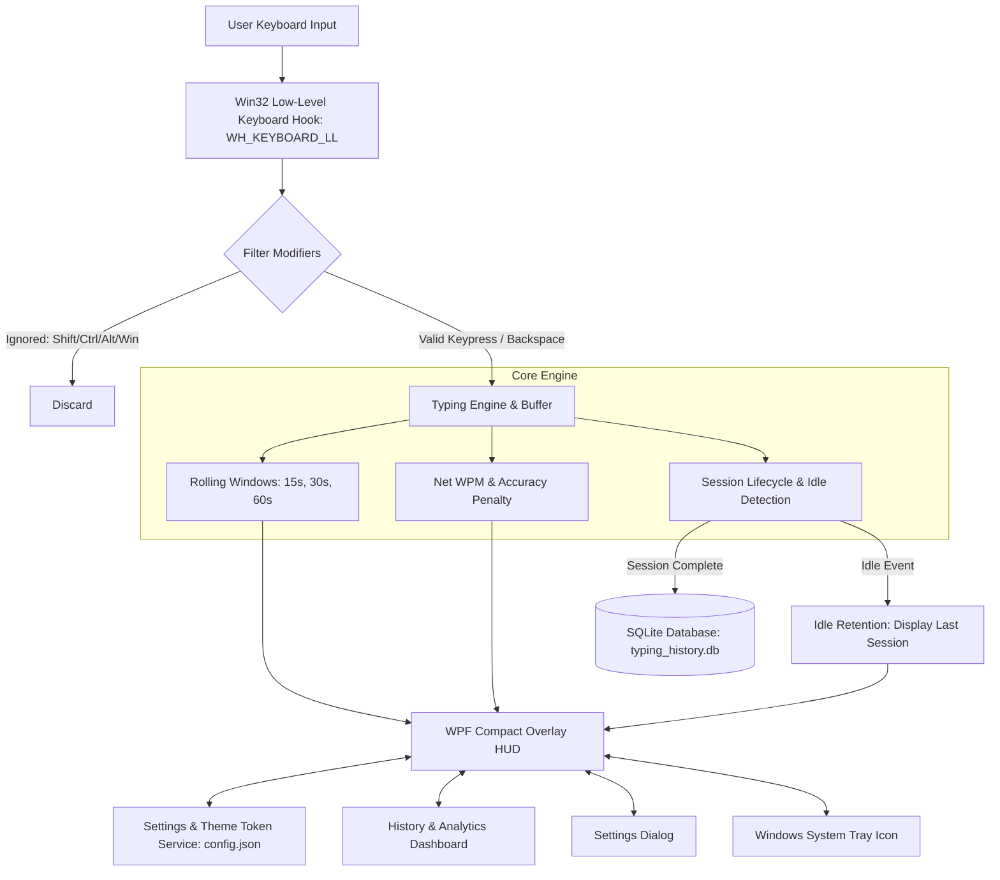

# System Architecture: WPM Overlay

## 1. System Overview

**WPM Overlay** is a high-performance, compact, hardware-accelerated Windows desktop application built with **C# / .NET 8 (WPF)**. It runs unobtrusively in the background, continuously monitoring keystrokes via a native Win32 low-level keyboard hook (`WH_KEYBOARD_LL`), and calculating real-time typing speed across rolling 15-second, 30-second, and 60-second sliding windows.

All session metrics, peak bursts, averages, and backspace counts are persisted locally in a lightweight **SQLite** database (`typing_history.db`).

---

## 2. High-Level Architecture Diagram

---

## 3. Subsystem Mechanics

### A. Input Hooking (`KeyboardHook.cs`)
- Installs an unmanaged low-level hook via `SetWindowsHookEx(WH_KEYBOARD_LL, ...)`.
- Operates on the standard Windows GUI message pump, introducing zero latency into typing.
- Explicitly filters out modifier keys (`VK_SHIFT`, `VK_CONTROL`, `VK_MENU`, `VK_LWIN`, `VK_CAPITAL`, etc.).
- Categorizes `VK_BACK` and `VK_DELETE` as correction events.

### B. Net WPM and Error Penalty Formula (`TypingEngine.cs`)
Standard Gross WPM assumes 5 keystrokes per word:
$$\text{Gross Words} = \frac{N_{\text{chars}}}{5}$$

To ensure deletions and mistypes do not falsely inflate typing speed, the engine computes **Net Characters**:
$$N_{\text{net}} = \max\Big(0, N_{\text{chars}} - N_{\text{backspace}} \times (1 + \text{PenaltyMultiplier})\Big)$$

With the default penalty multiplier ($1.0$), each backspace subtracts the character being erased plus penalizes the wasted keystroke.
$$\text{Net WPM} = \frac{N_{\text{net}} / 5}{T_{\text{elapsed}} / 60}$$

### C. Idle Retention & Auto-Hide Mechanics
- When typing ceases for longer than `AutoHideDelaySeconds` (default: 4.0s), the active session concludes and is automatically saved to SQLite.
- **Idle Retention**: Instead of resetting the HUD display to a flat zero, the HUD captures the peak 15s, 30s, 60s, and overall average of the session just finished.
- If `AutoHideEnabled` is active, the overlay fades out smoothly over 600ms via WPF double animation. Hovering the mouse over the HUD pauses auto-hide, allowing easy right-clicking and viewing.

### D. Persistence Layer (`DatabaseService.cs`)
- Powered by `Microsoft.Data.Sqlite`.
- Database file stored at `%APPDATA%\WPMOverlay\typing_history.db`.
- Schema:
  - `sessions`: Stores timestamped sessions with duration, gross keys, backspaces, net words, average WPM, peak 15s/30s/60s WPM, and accuracy percentage.
  - Indexed by `started_at` for high-speed queries.
- Exposes full CSV export and data purging.

### E. Theme & Color Tokens (`AppSettings.cs`, `better-colors`)
- Built following the `better-colors` standard:
  - `CyberDark`: Balanced Slate with sky-blue accents.
  - `OLEDMinimal`: Pitch black background with white and zinc text.
  - `MidnightBlue`: Deep navy sapphire surface with emerald highlights.
  - `EmeraldTerminal`: Vintage matrix green with emerald tokens.
  - `SunsetViolet`: Neon violet with rose highlights.
- Supports on-the-fly custom hex customization and window scale transform.
