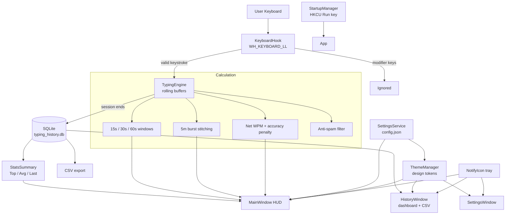
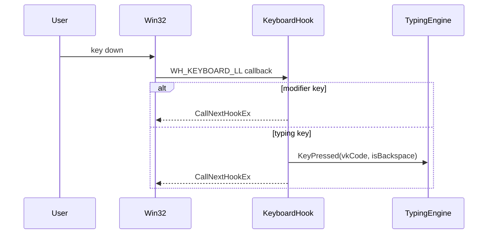
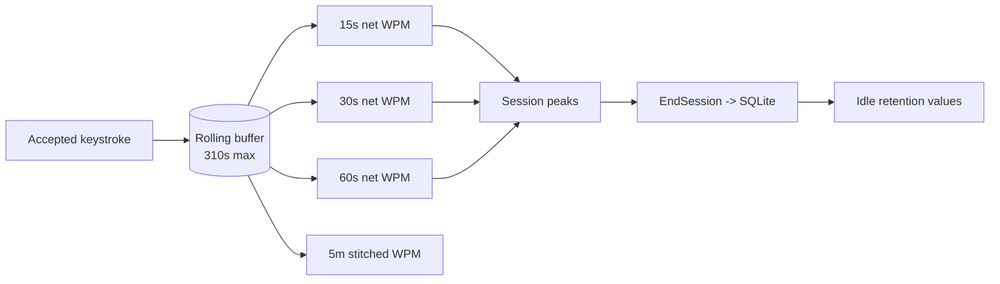
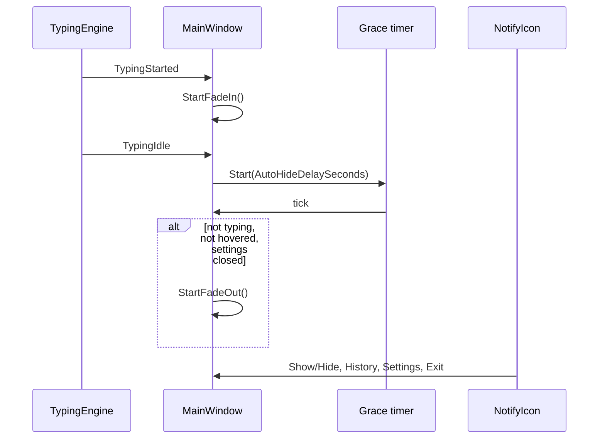

# System Architecture (`ARCHITECTURE.md`)
> **1-Line Summary:** Plain-English visual map of how WPM Overlay captures keys, calculates speed, stores history, and renders its themed HUD.

## 1. High-Level Visual System Map



## 2. Tech Stack & Why We Chose It

| Layer | Tool / Library | Plain-English Reason Why |
| --- | --- | --- |
| Language / runtime | C# on .NET 8 (`net8.0-windows`) | Modern, fast, and already installed on most Windows development machines. |
| UI framework | WPF | Transparent, borderless, hardware-accelerated windows are ideal for a floating HUD. |
| Tray integration | Windows Forms `NotifyIcon` | .NET has no first-class WPF tray icon; WinForms supplies a reliable one. |
| Input capture | Win32 `SetWindowsHookEx(WH_KEYBOARD_LL)` | The only way to observe keystrokes system-wide without per-app plugins. |
| Persistence | SQLite via `Microsoft.Data.Sqlite` | A single local file, zero server, fast indexed queries. |
| Configuration | `System.Text.Json` + `%APPDATA%\WPMOverlay\config.json` | Human-readable settings that survive restarts and are easy to back up. |
| Theming | WPF `DynamicResource` brushes | One token change repaints every open window without restarting. |
| Tests | xUnit + `Microsoft.NET.Test.Sdk` | Lightweight unit and UI-construction regression tests. |
| Packaging | `dotnet publish` single-file, self-contained `win-x64` | Produces one portable `.exe` with no installer. |
| CI / releases | GitHub Actions on `windows-latest` | Builds and tests every push; tag pushes publish portable binaries. |

## 3. Core Subsystems & Engineering Tricks

### [SUBSYSTEM: Global-Keyboard-Hook] | Aliases: KeyboardHook, WH_KEYBOARD_LL, hook callback, modifier filter
> **1-Line Summary:** Installs a low-level Windows hook and forwards only meaningful typing keys to the engine.
* **How It Works (Plain English):** The hook receives every key-down event, ignores Shift/Ctrl/Alt/Windows/CapsLock, treats Backspace and Delete as corrections, and immediately passes the event to the next hook so typing is never blocked.
* **Data Flow Diagram:**



* **Code Anchors (Grep Targets):**
  * `src/WPMOverlay/Services/KeyboardHook.cs` -> `KeyboardHook.Start`, `KeyboardHook.HookCallback`, `KeyboardHook.IsIgnoredModifier`, `KeyboardHook.Dispose`

### [SUBSYSTEM: Typing-Engine-And-Windows] | Aliases: TypingEngine, rolling buffer, 15s, 30s, 60s, 5m, burst stitching
> **1-Line Summary:** Turns a stream of keystrokes into live WPM windows, sustained pace, accuracy, and saved sessions.
* **How It Works (Plain English):** Every accepted keystroke is timestamped. A 150 ms timer prunes anything older than 310 seconds and recomputes each window from the kept records. The five-minute figure stitches bursts separated by 3.5 seconds or less and ignores longer reading pauses. A session is saved when it has at least 5 keystrokes and lasts at least 1.5 seconds.
* **Data Flow Diagram:**



* **Code Anchors (Grep Targets):**
  * `src/WPMOverlay/Services/TypingEngine.cs` -> `TypingEngine.OnKeyPressed`, `TypingEngine.OnCalcTimerElapsed`, `TypingEngine.CalculateWindowWpm`, `TypingEngine.CalculateSustained5mWpm`, `TypingEngine.EndSession`

### [SUBSYSTEM: Smart-Anti-Spam-Filter] | Aliases: IsValidTypingKeystroke, key hold, chatter, mash, oscillation
> **1-Line Summary:** Rejects physically implausible keystroke patterns so accidental noise never becomes a record.
* **How It Works (Plain English):** Rejects keys arriving under 30 ms apart, suppresses the third and later repeats of the same key, drops unbroken runs longer than 25 characters until a space/enter/tab/backspace boundary, and blocks a two-key alternating pattern after six entries.
* **Code Anchors (Grep Targets):**
  * `src/WPMOverlay/Services/TypingEngine.cs` -> `TypingEngine.IsValidTypingKeystroke`, `_consecutiveSameKeyCount`, `_unbrokenCharsWithoutBoundary`, `_recentKeyHistory`

### [SUBSYSTEM: SQLite-Persistence] | Aliases: DatabaseService, sessions table, WAL, typing_history.db
> **1-Line Summary:** Stores each completed session in a local SQLite file and answers summary, list, export, and delete queries.
* **How It Works (Plain English):** The database lives at `%APPDATA%\WPMOverlay\typing_history.db`, uses WAL journaling for responsiveness, indexes `started_at`, and is created automatically on first launch. The `sessions` table stores duration, gross keystrokes, backspaces, net words, average WPM, three peaks, and accuracy.
* **Code Anchors (Grep Targets):**
  * `src/WPMOverlay/Services/DatabaseService.cs` -> `DatabaseService.InitializeDatabase`, `DatabaseService.SaveSession`, `DatabaseService.GetStatsSummary`, `DatabaseService.GetRecentSessions`, `DatabaseService.ExportToCsv`, `DatabaseService.DeleteSessions`

### [SUBSYSTEM: Theme-Token-Engine] | Aliases: ThemeManager, DynamicResource, design tokens, light mode, contrast
> **1-Line Summary:** Converts a theme preset into shared WPF brushes and guarantees readable surfaces in both light and dark modes.
* **How It Works (Plain English):** `ThemeManager.ApplyTheme` computes perceived background luminance, derives `AppSurfaceBrush` and `AppSurfaceElevatedBrush`, chooses readable text-on-accent, and registers every brush in `Application.Current.Resources`. XAML references those brushes with `{DynamicResource ...}` so existing windows repaint immediately.
* **Code Anchors (Grep Targets):**
  * `src/WPMOverlay/Services/ThemeManager.cs` -> `ThemeManager.ApplyTheme`
  * `src/WPMOverlay/App.xaml` -> `AppBackgroundBrush`, `AppSurfaceBrush`, `AppTextPrimaryBrush`, `AppDividerBrush`
  * `src/WPMOverlay/Models/AppSettings.cs` -> `AppSettings.ApplyThemePreset`

### [SUBSYSTEM: Overlay-HUD-And-Tray] | Aliases: MainWindow, HUD, NotifyIcon, fade animation, drag
> **1-Line Summary:** Owns the floating card, fade animations, drag positioning, context menu, and system tray icon.
* **How It Works (Plain English):** A transparent, borderless, topmost window hosts the two-column card. A `DispatcherTimer` enforces the exact auto-hide grace period. A WinForms `NotifyIcon` provides Show/Hide, History, Settings, and Exit actions.
* **Data Flow Diagram:**



* **Code Anchors (Grep Targets):**
  * `src/WPMOverlay/Views/MainWindow.xaml.cs` -> `MainWindow.SetupTrayIcon`, `MainWindow.ApplySettings`, `MainWindow.UpdateVisuals`, `MainWindow.TriggerAutoHideGracePeriod`, `MainWindow.StartFadeOut`
  * `src/WPMOverlay/Views/MainWindow.xaml` -> `CardBorder`, `OverlayContextMenu`, `StatusDot`

### [SUBSYSTEM: Settings-And-Startup] | Aliases: SettingsService, config.json, SettingsWindow, registry run key
> **1-Line Summary:** Loads, edits, previews, and saves preferences, including the optional Windows startup entry.
* **How It Works (Plain English):** `SettingsService` reads and writes `%APPDATA%\WPMOverlay\config.json` and raises `SettingsUpdated`. The Settings window edits a temporary clone, can preview it live with `Apply Now`, and only commits on Save. `StartupManager` writes or removes `HKCU\Software\Microsoft\Windows\CurrentVersion\Run\WPMOverlay`.
* **Code Anchors (Grep Targets):**
  * `src/WPMOverlay/Services/SettingsService.cs` -> `SettingsService.Load`, `SettingsService.Save`, `SettingsService.UpdateSettings`
  * `src/WPMOverlay/Views/SettingsWindow.xaml.cs` -> `SettingsWindow.CommitToSettings`, `SettingsWindow.Apply_Click`, `SettingsWindow.SaveClose_Click`
  * `src/WPMOverlay/Services/StartupManager.cs` -> `StartupManager.SetStartup`, `StartupManager.IsStartupEnabled`

## 4. Verification & Health Checks

### [VERIFY: Build-Test-And-Package] | Aliases: dotnet build, dotnet test, publish, CI
> **1-Line Summary:** Run these commands before every commit to prove the app still builds, tests pass, and the portable exe still packages.
* **Restore & Build:** `dotnet build WPMOverlay.sln -c Release`
* **Automated Tests:** `dotnet test WPMOverlay.sln -c Release --no-build`
* **Portable Packaging:**

```powershell
dotnet publish src/WPMOverlay/WPMOverlay.csproj -c Release -r win-x64 `
  --self-contained true `
  -p:PublishSingleFile=true `
  -p:IncludeNativeLibrariesForSelfExtract=true `
  -p:EnableCompressionInSingleFile=true `
  -o artifacts/publish
```

* **Expected Artifact:** `artifacts/publish/WPMOverlay.exe`
* **Code Anchors (Grep Targets):**
  * `.github/workflows/ci.yml` -> `build-and-test`
  * `.github/workflows/release.yml` -> `publish-portable`

## 5. Recipes: How to Add New Things Safely

* **To add a new live metric:**
  1. Add the calculation in `src/WPMOverlay/Services/TypingEngine.cs` -> `TypingEngine.OnCalcTimerElapsed` or a dedicated `Calculate...` method.
  2. Expose a public property beside `Current15sWpm`.
  3. Add a `Row...` block in `src/WPMOverlay/Views/MainWindow.xaml` and update `MainWindow.UpdateVisuals`.
  4. Add a visibility toggle in `src/WPMOverlay/Models/AppSettings.cs` and `SettingsWindow.xaml` -> `GroupMetrics`.

* **To add a new theme preset:**
  1. Add a `case` in `src/WPMOverlay/Models/AppSettings.cs` -> `AppSettings.ApplyThemePreset`.
  2. Add a `ComboBoxItem` in `src/WPMOverlay/Views/SettingsWindow.xaml` -> `CmbPreset`.
  3. Verify every surface in `MainWindow`, `SettingsWindow`, and `HistoryWindow` uses `{DynamicResource ...}` rather than a hardcoded color.
  4. Add or update a hex-token assertion in `tests/WPMOverlay.Tests/TypingEngineTests.cs`.

* **To add a database column:**
  1. Extend the `CREATE TABLE` statement in `DatabaseService.InitializeDatabase`.
  2. Add a migration-safe `ALTER TABLE` path for existing installations if the column is required.
  3. Update `DatabaseService.SaveSession`, `GetRecentSessions`, and the CSV header in `ExportToCsv`.
  4. Update `TypingSession` and the `HistoryWindow` column bindings.

* **To add a new setting:**
  1. Add the property to `src/WPMOverlay/Models/AppSettings.cs` with a safe default.
  2. Include it in the clone inside `SettingsWindow`'s constructor.
  3. Read it in `SettingsWindow.CommitToSettings` and apply it in `MainWindow.ApplySettings`.
  4. Save it through `SettingsService.UpdateSettings`; never write `config.json` directly.
