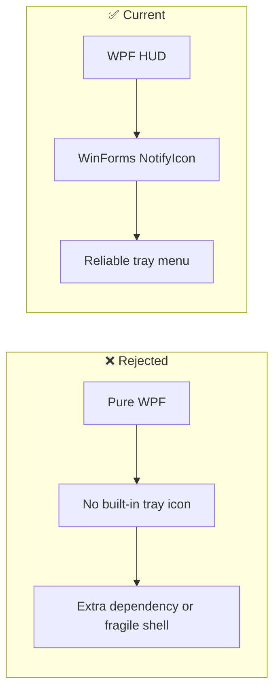
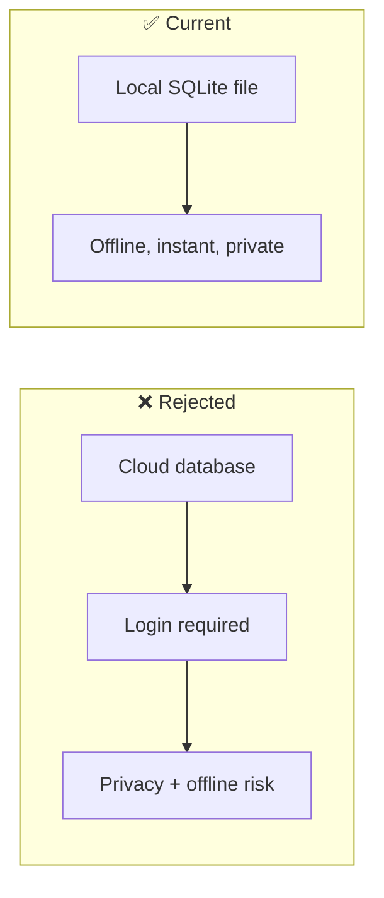
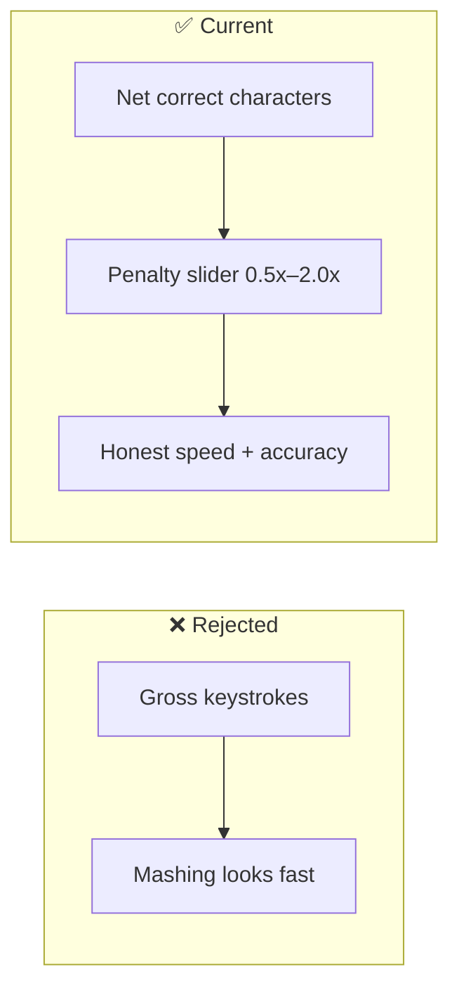
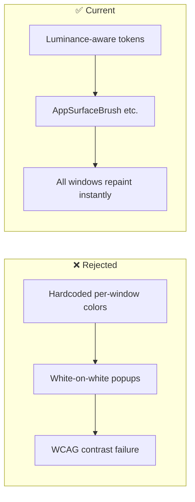

# Architectural Decisions, Pivots & Landmines (`DECISIONS_AND_TRAPS.md`)
> **1-Line Summary:** Records why the app is built this way, which alternatives failed, who made each choice, and the hidden code traps that must never be reopened.

## 1. Architectural Decisions & Pivot History

### [DECISION: WPF-HUD-With-WinForms-Tray] | Aliases: NotifyIcon, system tray, UseWindowsForms, framework choice
> **1-Line Summary:** Kept WPF for the overlay but enabled WinForms solely to get a dependable system-tray icon.
* **Decision Maker:** `[DECIDED BY: AGENT - Approved by Human]`
* **Original User Intention:** A transparent floating HUD that also stays reachable from the Windows tray.
* **Options Considered:**
  * **Option A (Rejected):** Pure WPF with a custom tray implementation. WPF has no built-in `NotifyIcon`, and third-party shells add unnecessary dependency weight.
  * **Option B (Chosen):** `<UseWPF>true</UseWPF>` plus `<UseWindowsForms>true</UseWindowsForms>`, using `System.Windows.Forms.NotifyIcon` only for the tray.
* **Visual Pivot Map (What Failed vs. What Works):**

* **Code Anchors (Grep Targets):**
  * `src/WPMOverlay/WPMOverlay.csproj` -> `UseWPF`, `UseWindowsForms`
  * `src/WPMOverlay/Views/MainWindow.xaml.cs` -> `MainWindow.SetupTrayIcon`

---

### [DECISION: Local-First-SQLite-Persistence] | Aliases: privacy, offline, database, typing_history.db
> **1-Line Summary:** Stores all history in a local SQLite file instead of a cloud account or remote API.
* **Decision Maker:** `[DECIDED BY: HUMAN]`
* **Original User Intention:** Own the typing data, keep it private, and keep the app fully offline.
* **Options Considered:**
  * **Option A (Rejected):** Cloud sync or a hosted dashboard. Introduces accounts, network latency, privacy risk, and ongoing cost.
  * **Option B (Chosen):** `%APPDATA%\WPMOverlay\typing_history.db` with WAL journaling and an index on `started_at`.
* **Visual Pivot Map (What Failed vs. What Works):**

* **Code Anchors (Grep Targets):**
  * `src/WPMOverlay/Services/DatabaseService.cs` -> `DatabaseService.InitializeDatabase`, `DatabaseService.SaveSession`

---

### [DECISION: Net-WPM-With-Error-Penalty] | Aliases: accuracy, backspace penalty, honest speed
> **1-Line Summary:** Counts net correct characters, not raw keystrokes, so fast sloppy typing cannot beat careful typing.
* **Decision Maker:** `[DECIDED BY: HUMAN]`
* **Original User Intention:** The displayed speed must reflect real typing performance.
* **Options Considered:**
  * **Option A (Rejected):** Gross WPM = characters ÷ 5 ÷ minutes. Backspaces and mistyped characters inflate the result.
  * **Option B (Chosen):** Net characters = max(0, typed − backspaces × (1 + penalty)); net WPM = net characters ÷ 5 ÷ active minutes.
* **Visual Pivot Map (What Failed vs. What Works):**

* **Code Anchors (Grep Targets):**
  * `src/WPMOverlay/Services/TypingEngine.cs` -> `TypingEngine.CalculateWindowWpm`, `TypingEngine.EndSession`
  * `src/WPMOverlay/Models/AppSettings.cs` -> `AppSettings.ErrorPenaltyMultiplier`

---

### [DECISION: Dynamic-Resource-Theme-Tokens] | Aliases: ThemeManager, hardcoded colors, contrast inversion, light mode
> **1-Line Summary:** Replaced hardcoded XAML colors with shared `DynamicResource` brushes so all nine themes stay readable everywhere.
* **Decision Maker:** `[DECIDED BY: AGENT - Approved by Human]`
* **Original User Intention:** No invisible labels or white-on-white popups when switching themes.
* **Options Considered:**
  * **Option A (Rejected):** Per-window hardcoded hex values. Light themes produced contrast inversions, and every new control needed manual color updates.
  * **Option B (Chosen):** A single `ThemeManager.ApplyTheme` computes surfaces and text-on-accent from the selected preset, then registers named brushes in `Application.Current.Resources`.
* **Visual Pivot Map (What Failed vs. What Works):**

* **Code Anchors (Grep Targets):**
  * `src/WPMOverlay/Services/ThemeManager.cs` -> `ThemeManager.ApplyTheme`
  * `src/WPMOverlay/App.xaml` -> `AppBackgroundBrush`, `AppSurfaceBrush`, `AppTextPrimaryBrush`, `AppDividerBrush`

---

### [DECISION: Burst-Stitched-Five-Minute-WPM] | Aliases: 5m sustained, active time, pause handling
> **1-Line Summary:** Calculates the five-minute metric from active typing time only, stitching bursts separated by short pauses.
* **Decision Maker:** `[DECIDED BY: HUMAN]`
* **Original User Intention:** A short pause to think or read must not collapse the sustained-speed result.
* **Options Considered:**
  * **Option A (Rejected):** Divide words by the full wall-clock five minutes. Reading pauses unfairly lower the score.
  * **Option B (Chosen):** Treat gaps of 3.5 seconds or less as continuous typing, sum only active burst durations, and divide net words by that active time.
* **Code Anchors (Grep Targets):**
  * `src/WPMOverlay/Services/TypingEngine.cs` -> `TypingEngine.CalculateSustained5mWpm`

---

### [DECISION: Source-Only-Repo-With-Tag-Releases] | Aliases: GitHub release, portable exe, repository hygiene
> **1-Line Summary:** Keeps compiled binaries out of git and publishes the portable `.exe` through tag-triggered GitHub Releases.
* **Decision Maker:** `[DECIDED BY: HUMAN]`
* **Original User Intention:** A clean, fast-cloning GitHub repository that still offers a one-click portable download.
* **Options Considered:**
  * **Option A (Rejected):** Commit portable executables into `releases/`. The first five versions added roughly 387 MB to git history and made every clone slow.
  * **Option B (Chosen):** Ignore `releases/`, build on a `v*` tag in GitHub Actions, and attach the single-file executable to the release.
* **Code Anchors (Grep Targets):**
  * `.gitignore` -> `releases/`
  * `.github/workflows/release.yml` -> `publish-portable`

---

## 2. Do-Not-Touch Engineering Landmines (Traps)

### [TRAP: SettingsWindow-Initialization-Order] | Aliases: NullReferenceException, _tempSettings, SliderOpacity_ValueChanged, InitializeComponent
> **1-Line Summary:** Never move the settings clone below `InitializeComponent`, and never remove the initialization guards.
* **Strict Rule:** **NEVER** construct `_tempSettings` after `InitializeComponent()`, and **NEVER** remove the `_isInitializing` / null checks from slider handlers.
* **Why This Trap Exists (Plain English):** WPF coerces slider values while parsing XAML, which raises `ValueChanged` before the constructor body finishes. If the temporary settings object is still null, the app throws `NullReferenceException` and the overlay disappears.
* **Protected Code Anchors (Grep Targets):**
  * `src/WPMOverlay/Views/SettingsWindow.xaml.cs` -> `SettingsWindow` constructor, `_isInitializing`, `SliderOpacity_ValueChanged`, `SliderHideDelay_ValueChanged`
  * `tests/WPMOverlay.Tests/TypingEngineTests.cs` -> `SettingsWindow_Instantiation_DoesNotThrowNullReferenceException`

---

### [TRAP: Assembly-Qualified-Pack-URIs] | Aliases: app_icon.ico, pack URI, testhost, Cannot locate resource
> **1-Line Summary:** Always use the fully qualified `/WPMOverlay;component/` pack URI for embedded resources.
* **Strict Rule:** **NEVER** shorten `pack://application:,,,/WPMOverlay;component/app_icon.ico` to `pack://application:,,,/app_icon.ico`.
* **Why This Trap Exists (Plain English):** The short form assumes the running entry assembly is `WPMOverlay.exe`. Test runners and secondary assemblies resolve the resource against `testhost.exe` instead, causing `IOException: Cannot locate resource 'app_icon.ico'`.
* **Protected Code Anchors (Grep Targets):**
  * `src/WPMOverlay/Views/MainWindow.xaml` -> `Icon`
  * `src/WPMOverlay/Views/SettingsWindow.xaml` -> `Icon`
  * `src/WPMOverlay/Views/HistoryWindow.xaml` -> `Icon`
  * `src/WPMOverlay/Views/MainWindow.xaml.cs` -> `MainWindow.SetupTrayIcon`

---

### [TRAP: WPF-WinForms-Type-Collisions] | Aliases: CS0104, ambiguous reference, Application, MessageBox, Color
> **1-Line Summary:** Keep explicit aliases for every type that exists in both WPF and WinForms.
* **Strict Rule:** **NEVER** remove the `WpfApplication`, `WpfColor`, `WpfColorConverter`, `WpfMessageBox`, or `WpfSaveFileDialog` aliases while both UI frameworks are enabled.
* **Why This Trap Exists (Plain English):** Enabling WPF and WinForms together imports two namespaces that both define `Application`, `Color`, `MessageBox`, `MouseEventArgs`, and more. Without aliases, the compiler stops with `CS0104: ambiguous reference`.
* **Protected Code Anchors (Grep Targets):**
  * `src/WPMOverlay/App.xaml.cs` -> `WpfApplication`
  * `src/WPMOverlay/Services/ThemeManager.cs` -> `WpfApplication`, `WpfColor`, `WpfColorConverter`
  * `src/WPMOverlay/Views/HistoryWindow.xaml.cs` -> `WpfMessageBox`, `WpfSaveFileDialog`
  * `src/WPMOverlay/Views/MainWindow.xaml.cs` -> `WpfColor`, `Forms.NotifyIcon`

---

### [TRAP: ComboBox-Popup-Tokenization] | Aliases: white dropdown, contrast inversion, DynamicComboBoxStyle, popup
> **1-Line Summary:** The theme dropdown must always use the tokenized template; the native popup renders a white surface.
* **Strict Rule:** **NEVER** replace `DynamicComboBoxStyle` with a default WPF `ComboBox` or remove the `Popup` / `ComboBoxItem` templates.
* **Why This Trap Exists (Plain English):** A stock WPF `ComboBox` popup inherits the system window brush, which is white. On dark or custom themes, light text becomes invisible or surrounding text inverts. The custom template paints the popup from dynamic theme tokens.
* **Protected Code Anchors (Grep Targets):**
  * `src/WPMOverlay/Views/SettingsWindow.xaml` -> `DynamicComboBoxToggleButton`, `DynamicComboBoxStyle`, `CmbPreset`

---

### [TRAP: Auto-Hide-Grace-Timer] | Aliases: instant hide, MouseLeave, ShowDialog, _autoHideGraceTimer
> **1-Line Summary:** Never hide the overlay directly on mouse-leave or settings-close; always route through the grace timer.
* **Strict Rule:** **NEVER** call `StartFadeOut()` or an idle handler directly from `Window_MouseLeave` or immediately after `settingsWin.ShowDialog()`.
* **Why This Trap Exists (Plain English):** The user configures a delay such as 10 seconds. Directly hiding on interaction ignores that setting and makes the overlay vanish instantly. The `DispatcherTimer` waits the exact configured interval and still respects hover and open-dialog state.
* **Protected Code Anchors (Grep Targets):**
  * `src/WPMOverlay/Views/MainWindow.xaml.cs` -> `_autoHideGraceTimer`, `MainWindow.TriggerAutoHideGracePeriod`, `MainWindow.Window_MouseLeave`, `MainWindow.OpenSettingsWindow`

---

### [TRAP: Anti-Spam-Filter-Thresholds] | Aliases: 30ms, 25 characters, 2 repeats, oscillation, IsValidTypingKeystroke
> **1-Line Summary:** Do not loosen the anti-spam thresholds without evidence and regression tests.
* **Strict Rule:** **NEVER** raise the 30 ms chatter floor, allow three or more identical consecutive keys, raise the 25-character unbroken limit, or remove the six-key oscillation check without new tests.
* **Why This Trap Exists (Plain English):** These thresholds are the only thing preventing held keys and keyboard mashing from generating fake 300+ WPM records. Loosening them silently corrupts the entire history and all personal bests.
* **Protected Code Anchors (Grep Targets):**
  * `src/WPMOverlay/Services/TypingEngine.cs` -> `TypingEngine.IsValidTypingKeystroke`
  * `tests/WPMOverlay.Tests/TypingEngineTests.cs` -> `SmartFiltering_ConsecutiveSameKey_DropsThirdAndLaterRepeats`, `SmartFiltering_ChatterUnder30ms_IsDropped`, `SmartFiltering_LongUnspacedMash_DropsAfter25CharsUntilBoundary`, `SmartFiltering_OscillationSpam_IsDropped`

---

### [TRAP: SQLite-WAL-Sidecar-Files] | Aliases: -wal, -shm, database lock, file deletion
> **1-Line Summary:** WAL mode creates sidecar files; never assume the `.db` file is the only artifact.
* **Strict Rule:** **NEVER** delete or move `typing_history.db` while the app or tests are running, and always ship/ignore `-wal` and `-shm` files together with it.
* **Why This Trap Exists (Plain English):** WAL journaling keeps recent writes in `typing_history.db-wal` until a checkpoint. Copying only the main file can lose the newest sessions, while deleting a locked database can corrupt it.
* **Protected Code Anchors (Grep Targets):**
  * `src/WPMOverlay/Services/DatabaseService.cs` -> `DatabaseService` constructor, `DatabaseService.InitializeDatabase`
  * `.gitignore` -> `*.db`, `*.db-shm`, `*.db-wal`

---

### [TRAP: Low-Level-Hook-Must-Never-Block] | Aliases: CallNextHookEx, typing lag, WH_KEYBOARD_LL, hook callback
> **1-Line Summary:** The hook callback must stay tiny and always call the next hook.
* **Strict Rule:** **NEVER** do database work, UI work, or heavy computation inside `HookCallback`, and **NEVER** skip `CallNextHookEx`.
* **Why This Trap Exists (Plain English):** Windows gives low-level hooks a very short deadline. Any delay is felt as system-wide typing lag, and failing to forward the event can swallow keystrokes in other applications.
* **Protected Code Anchors (Grep Targets):**
  * `src/WPMOverlay/Services/KeyboardHook.cs` -> `KeyboardHook.HookCallback`, `KeyboardHook.Start`
  * `src/WPMOverlay/Services/TypingEngine.cs` -> `TypingEngine.OnKeyPressed`
